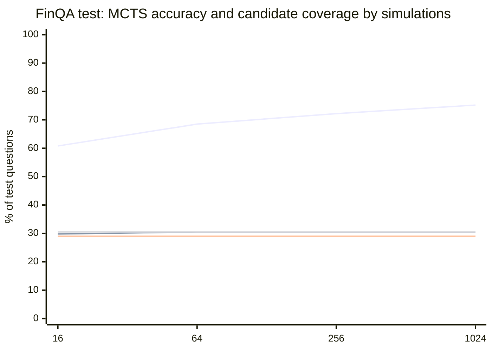
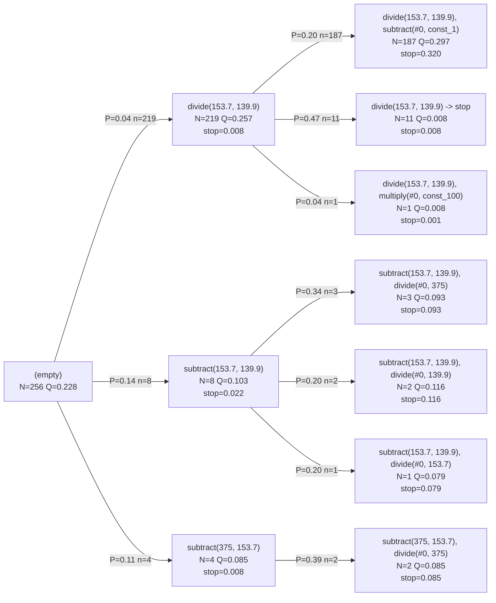

# finqa-program-search

Answers numerical questions about 10-K report pages by searching over small executable
programs (`subtract(5829, 5735), divide(#0, 5735)`) with PUCT Monte Carlo tree search.
A LightGBM action prior proposes the next step, a LightGBM program ranker judges finished
programs, an interpreter executes every candidate, and the numbers come from facts that a
BM25 + cross-encoder retriever picked from the page. Everything runs offline on a CPU.

The question this repository measures: on FinQA, how much accuracy does extra search
compute buy over greedy decoding and beam search, when all of them share one prior, one
verifier and one set of retrieved facts?

The answer here: a lot of coverage and no accuracy. Going from 16 to 1,024 simulations
raises the share of questions where MCTS scored a correct program from 60.8% to 75.2%,
but execution accuracy stops at 30.5% from 64 simulations on. That ties re-ranked beam
search (beam+ranker-5, 30.5%), and neither is distinguishable from greedy decoding
(29.0%) on this sample. The program ranker, not the search, sets the ceiling.

## Accuracy against simulations



Lines, in drawing order (Mermaid's chart has no legend): MCTS, a correct program was
scored; MCTS, execution accuracy; greedy, execution accuracy (flat); beam+ranker-5,
execution accuracy (flat, on top of the MCTS line from 64 simulations on).

| method | execution acc. | program acc. | a correct program was scored | p50 s | p95 s | programs scored (mean) |
| --- | ---: | ---: | ---: | ---: | ---: | ---: |
| greedy | 29.0% | 28.2% | 29.0% | 0.08 | 0.22 | - |
| beam-5 | 28.0% | 26.8% | 47.2% | 0.27 | 0.74 | - |
| beam-10 | 27.8% | 26.5% | 56.5% | 0.49 | 1.31 | - |
| beam+ranker-5 | 30.5% | 29.8% | 47.2% | 0.26 | 0.72 | 7 |
| beam+ranker-10 | 30.0% | 28.7% | 56.5% | 0.49 | 1.29 | 16 |
| depth2+ranker | 19.0% | 12.0% | 80.5% | 3.91 | 11.81 | 104,724 |
| mcts-16 | 29.8% | 27.8% | 60.8% | 0.38 | 0.90 | 32 |
| mcts-64 | 30.5% | 27.8% | 68.5% | 0.81 | 2.20 | 76 |
| mcts-256 | 30.5% | 27.8% | 72.2% | 2.12 | 5.19 | 204 |
| mcts-1024 | 30.5% | 27.8% | 75.2% | 5.02 | 11.21 | 530 |
| mcts-256 uniform prior (ablation) | 2.2% | 1.5% | 7.0% | 0.35 | 0.56 | 131 |
| MCTS with an LLM prior | not run | not run | not run | not run | not run | not run |

Test questions: a seeded random sample of 400 of the 1,147 test questions (seed 0). The
gold program is reachable in the search space for 75.5% of them; on the others a method
can only be right through a different program with the same value. Seconds are per
question in one process, six questions in parallel.

Measured on Intel(R) Core(TM) i5-8500 CPU @ 3.00GHz (6 cores, 12 GB RAM, Windows 10,
Python 3.12.14, CPU only) on 2026-10-13, commit `06ab0d0`. Source:
`bench/results/test.json`.

**Why a sample.** Training on all 6,251 training questions took 41 min and the test
stage took 19 min for these 400 questions (`wall_seconds` in `test.json`); the whole
test split plus the full dev grid did not fit the time budget of one benchmark session.
The sample sizes were set from that budget before any tuning or test result existed:
retrieval recall is measured on all dev and test questions, the models are trained on
all of train, the dev grid runs on a seeded sample of 200 of the 883 dev questions, the
test methods on 400 test questions, and latency on the first 60 of those 400. `bench/run.py` without the sample flags runs
the full splits; that run has not been done.

How to read it:

* **Execution accuracy** is FinQA's: the program's result equals `exe_ans` after rounding
  to five decimals (yes/no compared as words). **Program accuracy** asks whether the
  program computes the same expression as the gold program, with every number and
  constant treated as a symbol, as FinQA's own script does (checked by evaluating both
  at random points of a prime field, see `dsl.equivalent`).
* **A correct program was scored** counts questions where some program the method
  finished or scored executes to the right answer. Its gap to execution accuracy is the
  verifier picking the wrong candidate;
  [ADR 0002](docs/adr/0002-one-program-ranker-as-the-verifier.md) explains why the answer
  is picked by ranker *and* prior.
* Every method gets the same retrieved facts, the same prior and the same ranker.

### Which gaps 400 questions can resolve

Each method against greedy on the same 400 questions (`bench/results/compare.json`,
computed from the test stage's per-question records): the 95% Wilson interval of its
execution accuracy, and an exact sign test on the questions where exactly one of the
two is right.

| method | execution acc. | 95% interval | right where greedy is wrong | wrong where greedy is right | sign test p |
| --- | ---: | ---: | ---: | ---: | ---: |
| beam-5 | 28.0% | 23.8% to 32.6% | 6 | 10 | 0.45 |
| beam-10 | 27.8% | 23.6% to 32.3% | 6 | 11 | 0.33 |
| beam+ranker-5 | 30.5% | 26.2% to 35.2% | 25 | 19 | 0.45 |
| beam+ranker-10 | 30.0% | 25.7% to 34.7% | 26 | 22 | 0.67 |
| depth2+ranker | 19.0% | 15.5% to 23.1% | 25 | 65 | 3e-05 |
| mcts-16 | 29.8% | 25.5% to 34.4% | 25 | 22 | 0.77 |
| mcts-64 | 30.5% | 26.2% to 35.2% | 29 | 23 | 0.49 |
| mcts-256 | 30.5% | 26.2% to 35.2% | 29 | 23 | 0.49 |
| mcts-1024 | 30.5% | 26.2% to 35.2% | 29 | 23 | 0.49 |
| mcts-256 uniform prior | 2.2% | 1.2% to 4.2% | 3 | 110 | 4.6e-29 |

Two results are clear. The learned prior carries the search: with a uniform prior,
MCTS-256 falls to 2.2%. And handing the ranker every one- and two-step program at once
(depth2+ranker) is worse than greedy: it scores a correct program most often (80.5%)
but, choosing among 104,724 programs per question on average, picks one less often
than any other method except the uniform-prior ablation.
Whether MCTS or re-ranked beam search beats greedy is not resolved: each of those sign
tests has p of 0.45 or more.

What each step up the simulation ladder changed in the chosen answers:

| simulations | chosen program changed | newly right | newly wrong |
| --- | ---: | ---: | ---: |
| 16 to 64 | 25 | 4 | 1 |
| 64 to 256 | 11 | 0 | 0 |
| 256 to 1024 | 2 | 0 | 0 |

From 64 simulations on, the answers that change go from wrong to wrong (or right to
right); none goes from wrong to right.

### How the search settings were chosen

On the 200-question dev sample, at 64 simulations
(`bench/results/tune.json`):

| dev setting | execution acc. | p50 s |
| --- | ---: | ---: |
| greedy | 30.0% | 0.09 |
| beam-10 | 29.0% | 0.58 |
| mcts-64 c=0.5 fpu=0.0 w=1.0 | 32.0% | 0.85 |
| mcts-64 c=1.5 fpu=0.0 w=1.0 | 32.0% | 0.85 |
| mcts-64 c=4.0 fpu=0.0 w=1.0 | 32.0% | 0.84 |
| mcts-64 c=0.5 fpu=1.0 w=1.0 | 32.0% | 0.39 |
| mcts-64 c=1.5 fpu=1.0 w=1.0 | 32.0% | 0.57 |
| mcts-64 c=4.0 fpu=1.0 w=1.0 | 32.0% | 0.65 |
| mcts-64 c=0.5 fpu=0.0 w=0.0 | 29.0% | 0.86 |
| mcts-64 c=0.5 fpu=0.0 w=0.5 | 35.0% | 0.82 |
| mcts-64 c=0.5 fpu=0.0 w=2.0 | 29.5% | 0.77 |

`c` is `c_puct`, `fpu` the first-play urgency reduction, `w` the weight of the log prior
next to the log ranker probability when the answer is picked. The six `c`/`fpu` settings
tie on accuracy (their trees differ: `tune.json` has the node and programs-scored
counts), so the first one in grid order was kept; `w = 0.5` was then the best weight. The test run uses c_puct 0.5, no first-play
reduction and w = 0.5 for MCTS and for beam+ranker.

## Anatomy of one search tree

The first test question in file order whose gold program has two steps and that
MCTS-256 answers correctly (`bench/results/trace.json`), ADI/2011/page_61.pdf-2: *"what
is the percentage change in cash flow hedges in 2011 compare to the 2010?"* The
retriever put the gold fact first ("... $ 153.7 million and $ 139.9 million ,
respectively , of cash flow hedges ..."); FinQA's gold program is
`subtract(153.7, 139.9), divide(#0, 139.9)`.



Each node is a partial program with its visit count `N`, its mean value `Q` and the
ranker's probability that stopping there is correct; each edge carries the prior `P` of
that step and how often the search took it (the three most visited children, two levels
deep).

What happened:

* The prior liked `subtract(153.7, 139.9)` best at the root (P=0.14) and gave
  `divide(153.7, 139.9)` only P=0.04. After a few visits the values disagreed (Q 0.257
  under the divide, 0.103 under the subtract), and 219 of the 256 simulations went to
  the divide branch: the value, not the prior, steered this search.
* The answer, `divide(153.7, 139.9), subtract(#0, const_1)`, evaluates to 0.09864, the
  gold answer, so it counts for execution accuracy. It does not count for program
  accuracy, because with `const_1` as a symbol `a / b - 1` is not `(a - b) / b`.
* The gold-shaped program was found too (two visits) but the ranker gave it a stop
  probability of 0.116 against 0.320 for the one picked. Two programs with the same
  value get different scores because the ranker sees their form; this is the verifier
  weakness the accuracy table shows at scale.
* The whole search took 1.89 s, built 73 nodes and scored 242 finished programs.

The same trace opens in a static, collapsible HTML viewer that also lists unvisited
siblings, the retrieved facts and the leaf numbers the search could use. With the tuned
settings this rebuilds the tree above:

```bash
uv run finqa-search solve "ADI/2011/page_61.pdf-2" --split test --simulations 256 \
    --c-puct 0.5 --prior-weight 0.5 --out trace.json --html tree.html
uv run finqa-search view trace.json --mermaid     # a deeper Mermaid sketch
```

## The program language and what it cannot say

| element | written as | meaning |
| --- | --- | --- |
| arithmetic | `add`, `subtract`, `multiply`, `divide`, `exp` | two numeric arguments |
| comparison | `greater(a, b)` | yes/no; must be the last step |
| table | `table_sum`, `table_average`, `table_max`, `table_min` | `(row label, none)`, over the row's numeric cells |
| number | `5829`, `3.8%`, `-12.5` | commas ignored, `x%` is `x / 100` |
| constant | `const_100`, `const_1000`, `const_m1`, ... | named values |
| reference | `#0`, `#1`, ... | result of an earlier step |

`finqa-search program "subtract(5829, 5735), divide(#0, 5735)"` prints every step's
value and the canonical form. The data stage (`bench/results/data.json`) re-executes
every gold program against its recorded `exe_ans`: 6,249 of the 6,251 training programs,
all 883 dev programs and all 1,147 test programs reproduce; the two training programs
that do not are on a reviewed allowlist with the reason
(`src/finqa_search/fixtures/gold_allowlist.json`), and the integration tests fail on any
other mismatch. The same stage finds no question id, report page or (page, question)
pair shared between splits.

Two programs are the same node of the search when they have the same canonical form:
`add` and `multiply` sort their arguments, references are inlined, and leaves are
compared by value, so `add(5829, 12)` and `add(12, 5829)` share one node, and so does
`5,829` read from a table cell.

What the search space cannot express, by design:

* **More than four steps.** `max_steps = 4`. Of the 8,281 FinQA gold programs, 98.4%
  have one to four steps; 125 have five and 6 have six.
* **Numbers outside the top five facts and the question.** If retrieval misses the fact,
  the gold program is unreachable.
* **Constants in unusual slots.** A constant fills only the (operation, argument) pairs
  seen in training programs, and two constants never meet in one step.
* **`exp` of a raw number** (its base must be an earlier result) and **anything after
  `greater`**.
* **Unused intermediate steps.** A program may stop only when every result feeds a
  later step.

Under these rules and the retrieved facts, the gold program is reachable for 4,898 of
the 6,251 training questions (`bench/results/train.json`) and for 75.5% of the 400
sampled test questions.

## From report page to answer

```mermaid
flowchart LR
    Q["question + report page"] --> F["facts: sentences and linearised table rows"]
    F --> B["BM25, IDF from train pages"]
    B --> CE["int8 cross-encoder re-ranks the BM25 top 12"]
    CE --> N["numbers from the top 5 facts, with unit, year, percent and row label"]
    N --> S["typed step space: leaves, constants, earlier results, table rows"]
    S --> M["PUCT MCTS: progressive widening, transposition table, virtual loss"]
    P["LightGBM action prior"] -->|"P(step)"| M
    M -->|"finished programs"| X["interpreter"]
    X -->|"value, numbers used"| R["LightGBM program ranker"]
    R -->|"P(correct) as node value"| M
    M --> A["answer: max of log ranker + w log prior"]
    A --> T["search-trace JSON"]
    T --> V["static HTML tree viewer"]
```



1. **Facts.** Each sentence and each table row
   (`the 2009 of net revenue is $ 5,829 ;`) is a fact with the same id FinQA uses in
   `gold_inds`. BM25 ranks them with IDF fitted on training pages;
   `cross-encoder/ms-marco-MiniLM-L6-v2` (int8 ONNX, onnxruntime) re-scores the BM25
   top 12 and the two scores are fused after z-scoring. FinQA's own `table_retrieved` /
   `text_retrieved` fields are never read
   ([ADR 0003](docs/adr/0003-retrieval-without-the-shipped-retriever-outputs.md)).
2. **Leaves.** Numbers from the question and the five best facts, with the context the
   models need: row label, normalised column header, the year a number belongs to,
   whether it is a percentage, the unit ("in millions"), a bracketed-negative hint.
   Equal values merge into one leaf. Typed constants (`const_100`, `const_1000`, ...)
   follow.
3. **Moves.** One move appends one step whose arguments are leaf, constant, earlier
   result or table-row indices; typing rules prune illegal programs before they exist
   ([ADR 0001](docs/adr/0001-typed-action-space-with-canonical-keys.md)).
4. **Prior.** A LightGBM LambdaRank model scores every legal step of a state in one
   batched call (operation, both argument descriptions, how they relate, what the step
   evaluates to, cue words of the question), turned into a distribution by a softmax.
   It is fitted on the gold trajectories of the training questions whose gold program
   is reachable, with sampled legal steps as negatives.
5. **Ranker.** A LightGBM classifier of "this finished program answers the question",
   fitted on programs labelled by execution. Candidates come from searches whose models
   never saw the question (3-fold cross-fitting by report page): beam search, prior
   samples and uniform depth-2 draws first, then every program an MCTS run scored. The
   benchmark's ranker saw 912,912 labelled programs (1.6% correct), 472,521 of them from
   the MCTS round; the model files are 1,421,331 bytes (prior) and 2,096,814 bytes
   (ranker).
6. **Search.** PUCT with progressive widening, a transposition table keyed by the
   canonical form of the partial program, virtual loss for batched leaf evaluation, and
   root parallelism across processes
   ([ADR 0004](docs/adr/0004-root-parallel-trees-and-virtual-loss.md)). A new node's
   value is the ranker's best probability among stopping now and its three most likely
   next steps.
7. **Baselines over the same space:** greedy decoding, beam search on summed log prior
   (optionally re-ranked), and exhaustive enumeration of every one- and two-step program
   scored by the ranker alone.

An LLM can be mixed into the prior through `finqa_search.llm.LLMPrior` and any
OpenAI-compatible endpoint (OpenAI, Ollama, vLLM, LM Studio): `finqa-search solve ...
--llm-url http://localhost:11434/v1 --llm-model <name>`. Its proposals are parsed with the
same program parser and kept only when they are legal moves. No benchmark here uses it;
the tests drive it with a scripted fake provider and a local HTTP stub.

## Fact recall and seconds per question

On all dev and test questions (`bench/results/retrieval.json`):

| split | ranker | Recall@1 | Recall@3 | Recall@5 | all gold facts in top 3 |
| --- | --- | ---: | ---: | ---: | ---: |
| dev | BM25 | 49.9% | 74.0% | 83.0% | 59.8% |
| dev | BM25 + cross-encoder | 51.4% | 75.6% | 84.7% | 61.7% |
| test | BM25 | 49.9% | 72.4% | 81.3% | 58.2% |
| test | BM25 + cross-encoder | 53.9% | 74.9% | 82.3% | 60.6% |

Recall@k is the share of a question's `gold_inds` facts found in the top k. Ranking the
facts of a question takes 0.55 s at the median and 0.93 s at p95 on test (0.52 s and
0.90 s on dev), six questions in parallel.

MCTS-256 latency (`bench/results/latency.json`), one question at a time:

| workers | trees x simulations | p50 s | p95 s | mean s | execution acc. |
| --- | --- | ---: | ---: | ---: | ---: |
| 1 worker | 1 x 256 | 1.81 | 3.34 | 1.89 | 36.7% |
| 6 workers | 6 x 42-43 | 0.85 | 1.67 | 0.91 | 36.7% |

Latency questions: the first 60 of the 400 sampled test questions, so the accuracy
column is not comparable with the table above. The clock runs from handing a question's
trees to a warm process pool until the merged answer is back, including building the
question context in every worker. Six root-parallel trees of 42-43 simulations cut the
median from 1.81 s to 0.85 s with the same accuracy on these 60 questions.

Measured on Intel(R) Core(TM) i5-8500 CPU @ 3.00GHz (6 cores, 12 GB RAM, Windows 10,
Python 3.12.14, CPU only) on 2026-10-13, commit `06ab0d0`.

## Try it offline, then on FinQA

Offline, on the 50 FinQA training questions bundled with the package (BM25 retrieval,
small models fitted on 40 of them, three searches on the other 10, a trace and its HTML
viewer). The accuracies it prints say nothing about FinQA; it shows the whole path
working and is what CI and the Docker smoke test run:

```bash
uv sync
uv run finqa-search demo --out finqa-demo
```

The full pipeline:

```bash
export FINQA_SEARCH_DATA_DIR=~/.cache/finqa-program-search   # the default
uv run finqa-search fetch          # FinQA + cross-encoder, sha256-checked
uv run finqa-search retrieve       # rank facts for train/dev/test (cached)
uv run finqa-search train          # action prior + program ranker
uv run finqa-search run --split dev --method mcts --simulations 64 --limit 100
uv run finqa-search solve "ETR/2016/page_23.pdf-2" --split test --html tree.html
```

Tests: `uv run pytest` runs the fast suite (no network, no downloads, the bundled
fixture); `uv run pytest -m integration` adds the checks against the real splits and the
cross-encoder.

Docker (CPU only; mount a directory for the data):

```bash
docker build -t finqa-program-search .
docker run --rm finqa-program-search demo --out /tmp/demo
docker run --rm -v "$PWD/data:/data" finqa-program-search fetch
```

## Reproducing the numbers

Every figure above comes from `bench/results/*.json`, which also record the machine,
date, git commit and command. `bench/report.py` prints the tables and charts of this
README from them. One command recomputes all of it, the sample included:

```bash
uv run python bench/run.py --workers 6 --dev-questions 200 --test-questions 400 \
    --latency-questions 60 --seed 0
uv run python bench/report.py
```

The published files came from these invocations, in order:

```bash
uv run python bench/run.py --workers 6 --reuse-rankings --stages data,retrieval
uv run python bench/run.py --workers 6 --stages train
uv run python bench/run.py --workers 6 --dev-questions 200 --test-questions 400 \
    --latency-questions 60 --seed 0 --stages tune,test,latency,trace
uv run python bench/run.py --workers 6 --dev-questions 200 --test-questions 400 \
    --latency-questions 60 --seed 0 --stages compare
```

`--reuse-rankings` kept the cached fact rankings of the train split, which only feed
training; the dev and test rankings were recomputed and came out identical to that
cache, and `retrieval.json` records no timing for the reused split. The `compare` stage
was added after the test run and reads its per-question records, so `compare.json`
carries a later commit plus the commit and date of the test run it read. `--stages`
runs any subset; `--smoke` runs tiny subsets into `smoke-*.json`, which are not results
and are not committed.

## Where the data and the cross-encoder come from

| what | source | licence | how it is used |
| --- | --- | --- | --- |
| FinQA (train/dev/test) | [czyssrs/FinQA](https://github.com/czyssrs/FinQA), pinned commit | MIT | downloaded by `finqa-search fetch`; 50 training questions ship in `src/finqa_search/fixtures/` with the FinQA licence next to them |
| ms-marco-MiniLM-L6-v2 cross-encoder | [cross-encoder/ms-marco-MiniLM-L6-v2](https://huggingface.co/cross-encoder/ms-marco-MiniLM-L6-v2), int8 ONNX export, pinned revision | Apache-2.0 | downloaded by `finqa-search fetch`, never committed |
| action prior, program ranker | trained here by `finqa-search train` | MIT (this repository) | written to the data directory, never committed |

Every download is checked against the sha256 recorded in `src/finqa_search/sources.py`
(recorded on the first download); `finqa-search verify` re-hashes what is on disk.

## Known weaknesses

* **The verifier is the bottleneck, measurably.** At 1,024 simulations a correct program
  was scored for 75.2% of the questions and picked for 30.5%. The ranker is a
  gradient-boosted model over hand-built features with no reading comprehension, and it
  scores equal-valued programs differently by form (see the search tree above). More
  search cannot fix that; a better verifier would turn coverage into accuracy.
* **A sample, not the full test split.** 400 of 1,147 test questions and 200 of 883 dev
  questions. The 95% intervals of the leading methods run from about 26% to 35%, so
  differences of a point or two between greedy, beam+ranker and MCTS are not
  established either way. The prior weight `w = 0.5` was picked on 200 dev questions.
* **Grounding is lexical.** Which number a question means is decided by token overlap
  with row labels, headers and nearby words plus the retriever's fact order; questions
  that paraphrase the table need semantics these models do not have.
* **Closed program space.** See the list under the program language; the gold program
  is reachable for only 75.5% of the sampled test questions.
* **One retriever setting.** Pool size and fusion weight were set once, not tuned.
* **No LLM numbers.** The LLM prior is implemented and tested with a fake provider only;
  any accuracy with a real model is not run.
* **One machine.** Timings are from one Windows desktop; process start-up and
  `spawn` costs differ on Linux.

## Decisions written down

* [ADR 0001](docs/adr/0001-typed-action-space-with-canonical-keys.md): search over a
  typed step space, not over program text
* [ADR 0002](docs/adr/0002-one-program-ranker-as-the-verifier.md): a program-only ranker
  steers the search; ranker and prior pick the answer
* [ADR 0003](docs/adr/0003-retrieval-without-the-shipped-retriever-outputs.md): our own
  fact ranking, cached per split
* [ADR 0004](docs/adr/0004-root-parallel-trees-and-virtual-loss.md): root parallelism
  across processes, virtual loss inside a tree

MIT licence, copyright (c) 2026 Daniel Lopez.
