# finqa-program-search

Answers numerical questions about 10-K report pages by searching over small executable
programs (`subtract(5829, 5735), divide(#0, 5735)`) with PUCT Monte Carlo tree search.
A LightGBM action prior proposes the next step, a LightGBM program ranker judges finished
programs, an interpreter executes every candidate, and the numbers come from facts that a
BM25 + cross-encoder retriever picked from the page. Everything runs offline on a CPU.

The question this repository measures: on FinQA, how much accuracy does extra search
compute buy over greedy decoding and beam search, when all of them share one prior, one
verifier and one set of retrieved facts?

## Accuracy against simulations

> **Pending benchmark.** The chart and the table below are produced by
> `uv run python bench/run.py` and formatted by `uv run python bench/report.py`; they
> have not been run for this commit.

```text
x: MCTS simulations per question (16, 64, 256, 1024)
y: % of the FinQA test questions
lines: share of questions where MCTS scored at least one correct program,
       execution accuracy of MCTS, greedy decoding, best beam search with re-ranking
(pending benchmark)
```

| method | execution acc. | program acc. | a correct program was scored | p50 s | p95 s |
| --- | ---: | ---: | ---: | ---: | ---: |
| greedy (prior only) | pending | pending | pending | pending | pending |
| beam-5, beam-10 (prior only) | pending | pending | pending | pending | pending |
| beam+ranker-5, beam+ranker-10 | pending | pending | pending | pending | pending |
| depth-2 exhaustive + ranker | pending | pending | pending | pending | pending |
| MCTS 16 / 64 / 256 / 1024 | pending | pending | pending | pending | pending |
| MCTS 256, uniform prior (ablation) | pending | pending | pending | pending | pending |
| MCTS with an LLM prior | not run | not run | not run | not run | not run |

Measured on: Intel i5-8500 (6 cores), 12 GB RAM, Windows 10, CPU only; date pending
benchmark.

How to read it:

* **Execution accuracy** is FinQA's: the program's result equals `exe_ans` after rounding
  to five decimals (yes/no compared as words). **Program accuracy** asks whether the
  program computes the same expression as the gold program (checked by evaluating both
  at random points of a prime field, see `dsl.equivalent`).
* **A correct program was scored** counts questions where some program the method
  finished or scored executes to the right answer. Its gap to execution accuracy is the
  verifier picking the wrong candidate;
  [ADR 0002](docs/adr/0002-one-program-ranker-as-the-verifier.md) explains why the answer
  is picked by ranker *and* prior.
* Every method gets the same retrieved facts, the same prior and the same ranker. Search
  settings (`c_puct`, first-play urgency, prior weight) were tuned on dev only; the dev
  grid is in `bench/results/tune.json`.

## Anatomy of one search tree

> **Pending benchmark.** `bench/run.py --stages trace` picks the first test question
> (in file order) whose gold program has two steps and that MCTS-256 answers correctly,
> stores its full trace in `bench/results/trace.json` and draws the most visited part
> of the tree as a Mermaid diagram for this section.

Every node shows the partial program, its visit count `N`, its mean value `Q` and the
ranker's probability that stopping there is correct; every edge shows the prior `P` of
that step and how often the search took it. The same trace opens in a static,
collapsible HTML viewer that also lists unvisited siblings, the retrieved facts and the
leaf numbers the search could use:

```bash
uv run finqa-search solve "ETR/2016/page_23.pdf-2" --split test --simulations 256 \
    --out trace.json --html tree.html
uv run finqa-search view trace.json --mermaid     # the diagram form
```

## The program language and what it cannot say

| element | written as | meaning |
| --- | --- | --- |
| arithmetic | `add`, `subtract`, `multiply`, `divide`, `exp` | two numeric arguments |
| comparison | `greater(a, b)` | yes/no; must be the last step |
| table | `table_sum`, `table_average`, `table_max`, `table_min` | `(row label, none)`, over the row's numeric cells |
| number | `5829`, `3.8%`, `-12.5` | commas ignored, `x%` is `x / 100` |
| constant | `const_100`, `const_1000`, `const_m1`, ... | named values |
| reference | `#0`, `#1`, ... | result of an earlier step |

`finqa-search program "subtract(5829, 5735), divide(#0, 5735)"` prints every step's
value and the canonical form. `bench/run.py --stages data` re-executes every gold program
in the three splits against its recorded `exe_ans`; the two training programs that do not
reproduce are on a reviewed allowlist with the reason
(`src/finqa_search/fixtures/gold_allowlist.json`), and the integration tests fail on any
other mismatch.

Two programs are the same node of the search when they have the same canonical form:
`add` and `multiply` sort their arguments, references are inlined, and leaves are
compared by value, so `add(5829, 12)` and `add(12, 5829)` share one node, and so does
`5,829` read from a table cell.

What the search space cannot express, by design:

* **More than four steps.** `max_steps = 4`. The data stage reports how many gold
  programs are longer.
* **Numbers outside the top five facts and the question.** If retrieval misses the fact,
  the gold program is unreachable.
* **Constants in unusual slots.** A constant fills only the (operation, argument) pairs
  seen in training programs, and two constants never meet in one step.
* **`exp` of a raw number** (its base must be an earlier result) and **anything after
  `greater`**.
* **Unused intermediate steps.** A program may stop only when every result feeds a
  later step.

The share of questions whose gold program is reachable under these rules is reported
next to every accuracy figure (pending benchmark).

## From report page to answer

```mermaid
flowchart LR
    Q["question + report page"] --> F["facts: sentences and linearised table rows"]
    F --> B["BM25, IDF from train pages"]
    B --> CE["int8 cross-encoder re-ranks the BM25 top 12"]
    CE --> N["numbers from the top 5 facts, with unit, year, percent and row label"]
    N --> S["typed step space: leaves, constants, earlier results, table rows"]
    S --> M["PUCT MCTS: progressive widening, transposition table, virtual loss"]
    P["LightGBM action prior"] -->|"P(step)"| M
    M -->|"finished programs"| X["interpreter"]
    X -->|"value, numbers used"| R["LightGBM program ranker"]
    R -->|"P(correct) as node value"| M
    M --> A["answer: max of log ranker + w log prior"]
    A --> T["search-trace JSON"]
    T --> V["static HTML tree viewer"]
```



1. **Facts.** Each sentence and each table row ("the 2009 of net revenue is $ 5,829 ;")
   is a fact with the same id FinQA uses in `gold_inds`. BM25 ranks them with IDF fitted
   on training pages; `cross-encoder/ms-marco-MiniLM-L6-v2` (int8 ONNX, onnxruntime)
   re-scores the BM25 top 12 and the two scores are fused after z-scoring.
   FinQA's own `table_retrieved` / `text_retrieved` fields are never read
   ([ADR 0003](docs/adr/0003-retrieval-without-the-shipped-retriever-outputs.md)).
2. **Leaves.** Numbers from the question and the five best facts, with the context the
   models need: row label, normalised column header, the year a number belongs to,
   whether it is a percentage, the unit ("in millions"), a bracketed-negative hint.
   Equal values merge into one leaf. Typed constants (`const_100`, `const_1000`, ...)
   follow.
3. **Moves.** One move appends one step whose arguments are leaf, constant, earlier
   result or table-row indices; typing rules prune illegal programs before they exist
   ([ADR 0001](docs/adr/0001-typed-action-space-with-canonical-keys.md)).
4. **Prior.** A LightGBM LambdaRank model scores every legal step of a state in one
   batched call (operation, both argument descriptions, how they relate, what the step
   evaluates to, cue words of the question), turned into a distribution by a softmax.
   It is fitted on the gold trajectories of the training questions whose gold program
   is reachable, with sampled legal steps as negatives.
5. **Ranker.** A LightGBM classifier of "this finished program answers the question",
   fitted on programs labelled by execution. Candidates come from searches whose models
   never saw the question (3-fold cross-fitting by report page): beam search, prior
   samples and uniform depth-2 draws first, then every program an MCTS run scored.
6. **Search.** PUCT with progressive widening, a transposition table keyed by the
   canonical form of the partial program, virtual loss for batched leaf evaluation, and
   root parallelism across processes
   ([ADR 0004](docs/adr/0004-root-parallel-trees-and-virtual-loss.md)). A new node's
   value is the ranker's best probability among stopping now and its three most likely
   next steps.
7. **Baselines over the same space:** greedy decoding, beam search on summed log prior
   (optionally re-ranked), and exhaustive enumeration of every one- and two-step program
   scored by the ranker alone.

An LLM can be mixed into the prior through `finqa_search.llm.LLMPrior` and any
OpenAI-compatible endpoint (OpenAI, Ollama, vLLM, LM Studio): `finqa-search solve ...
--llm-url http://localhost:11434/v1 --llm-model <name>`. Its proposals are parsed with the
same program parser and kept only when they are legal moves. No benchmark here uses it;
the tests drive it with a scripted fake provider and a local HTTP stub.

## Fact recall and seconds per question

| split | ranker | Recall@1 | Recall@3 | Recall@5 | all gold facts in top 3 |
| --- | --- | ---: | ---: | ---: | ---: |
| dev / test | BM25 | pending | pending | pending | pending |
| dev / test | BM25 + cross-encoder | pending | pending | pending | pending |

Recall@k is the share of a question's `gold_inds` facts found in the top k.

| workers | trees x simulations | p50 s | p95 s | execution acc. |
| --- | --- | ---: | ---: | ---: |
| 1 | 1 x 256 | pending | pending | pending |
| 6 | 6 x 42-43 (root parallelism) | pending | pending | pending |

Latency is wall-clock per question with a warm process pool, including building the
question context in every worker; the accuracy table above was run with six
question-parallel workers, one question per process.

## Try it offline, then on FinQA

Offline, on the 50 FinQA training questions bundled with the package (BM25 retrieval,
small models fitted on 40 of them, three searches on the other 10, a trace and its HTML
viewer). The accuracies it prints say nothing about FinQA; it shows the whole path
working and is what CI and the Docker smoke test run:

```bash
uv sync
uv run finqa-search demo --out finqa-demo
```

The full pipeline:

```bash
export FINQA_SEARCH_DATA_DIR=~/.cache/finqa-program-search   # the default
uv run finqa-search fetch          # FinQA + cross-encoder, sha256-checked
uv run finqa-search retrieve       # rank facts for train/dev/test (cached)
uv run finqa-search train          # action prior + program ranker
uv run finqa-search run --split dev --method mcts --simulations 64 --limit 100
uv run finqa-search solve "ETR/2016/page_23.pdf-2" --split test --html tree.html
```

Reproduce every number in this README (stages can be run one at a time with
`--stages`; `--smoke` runs tiny subsets and writes `bench/results/smoke-*.json`, which
are not results):

```bash
uv run python bench/run.py --workers 6
uv run python bench/report.py
```

Tests: `uv run pytest` runs the fast suite (no network, no downloads, the bundled
fixture); `uv run pytest -m integration` adds the checks against the real splits and the
cross-encoder.

Docker (CPU only; mount a directory for the data):

```bash
docker build -t finqa-program-search .
docker run --rm finqa-program-search demo --out /tmp/demo
docker run --rm -v "$PWD/data:/data" finqa-program-search fetch
```

## Where the data and the cross-encoder come from

| what | source | licence | how it is used |
| --- | --- | --- | --- |
| FinQA (train/dev/test) | [czyssrs/FinQA](https://github.com/czyssrs/FinQA), pinned commit | MIT | downloaded by `finqa-search fetch`; 50 training questions ship in `src/finqa_search/fixtures/` with the FinQA licence next to them |
| ms-marco-MiniLM-L6-v2 cross-encoder | [cross-encoder/ms-marco-MiniLM-L6-v2](https://huggingface.co/cross-encoder/ms-marco-MiniLM-L6-v2), int8 ONNX export, pinned revision | Apache-2.0 | downloaded by `finqa-search fetch`, never committed |
| action prior, program ranker | trained here by `finqa-search train` | MIT (this repository) | written to the data directory, never committed |

Every download is checked against the sha256 recorded in `src/finqa_search/sources.py`
(recorded on the first download); `finqa-search verify` re-hashes what is on disk.

## Known weaknesses

* **The verifier is the bottleneck.** The ranker is a gradient-boosted model over
  hand-built features; it has no reading comprehension. A search can score a correct
  program and still prefer a wrong one, which the "a correct program was scored" column
  makes visible.
* **Grounding is lexical.** Which number a question means is decided by token overlap
  with row labels, headers and nearby words plus the retriever's fact order; questions
  that paraphrase the table need semantics these models do not have.
* **Closed program space.** See the list under the program language; unreachable gold
  programs cap accuracy no matter how long the search runs.
* **One retriever setting.** Pool size and fusion weight were set once, not tuned.
* **No LLM numbers.** The LLM prior is implemented and tested with a fake provider only;
  any accuracy with a real model is not run.
* **One machine.** Timings are from one Windows desktop; process start-up and
  `spawn` costs differ on Linux.

## Decisions written down

* [ADR 0001](docs/adr/0001-typed-action-space-with-canonical-keys.md): search over a
  typed step space, not over program text
* [ADR 0002](docs/adr/0002-one-program-ranker-as-the-verifier.md): a program-only ranker
  steers the search; ranker and prior pick the answer
* [ADR 0003](docs/adr/0003-retrieval-without-the-shipped-retriever-outputs.md): our own
  fact ranking, cached per split
* [ADR 0004](docs/adr/0004-root-parallel-trees-and-virtual-loss.md): root parallelism
  across processes, virtual loss inside a tree

MIT licence, copyright (c) 2026 Daniel Lopez.
